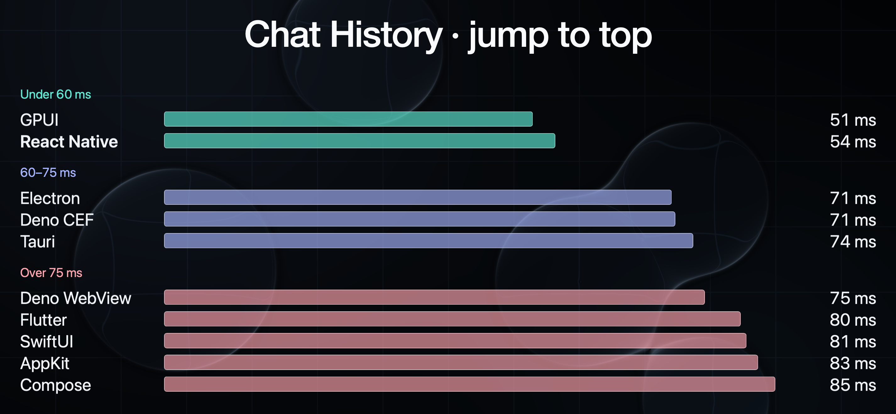
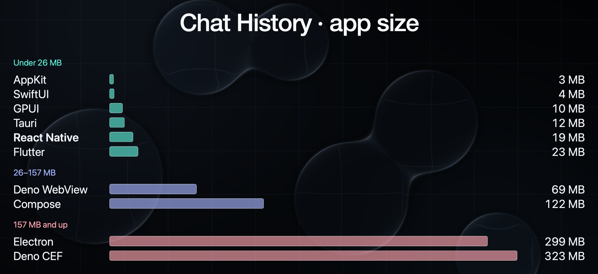
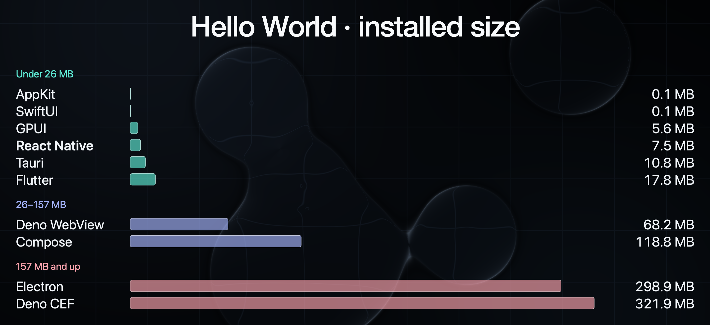

# Framework Benchmarks

Two release-mode macOS workloads compare desktop frameworks: a minimal **Hello World** app and a **Chat History** browser with Markdown and syntax highlighting. Implementations cover React Native, Electron, Tauri, Deno Desktop (WebView and CEF), Flutter, GPUI, Compose Multiplatform, SwiftUI, and AppKit. Each benchmark owns its apps, harness, charts, and latest results.

## Latest results

Apple M4, ARM64, macOS 26.6.1; medians of ten fresh-process observations after two warmups, with warm filesystem caches. Timings come from recordings; memory is settled physical footprint from separate unrecorded launches. Sizes are logical MiB, exclude system frameworks, and list chat grammar packs separately. Lower is better; small timing differences near the recording cadence are effectively tied.

### Chat History — September 23–24, 2026

> These results predate the published sample chats in `ChatHistory/fixtures/`; they were measured on the author’s local Codex and Claude history. A rerun on the sample set is pending.

[Results and raw data](ChatHistory/results/) · [Conditions and p90](ChatHistory/results/results.md).

| App | Window ms | First content ms | Jump ms | Switch ms | Initial MiB | App MiB | Grammar MiB |
| --- | ---: | ---: | ---: | ---: | ---: | ---: | ---: |
| AppKit | 244.1 | 344.3 | 82.6 | 96.7 | 43.6 | 3.2 | 1.3 |
| GPUI | 227.8 | 360.6 | 51.3 | 178.2 | 61.8 | 9.9 | 0.8 |
| React Native | 258.9 | 409.6 | 71.0 | 200.5 | 55.5 | 17.8 | 22.5 |
| Tauri | 275.6 | 609.0 | 73.6 | 227.2 | 139.7 | 11.5 | 0.1 |
| SwiftUI | 291.3 | 676.7 | 81.0 | 556.6 | 85.0 | 3.7 | 1.3 |
| Electron | 294.5 | 1185.8 | 70.6 | 604.1 | 259.0 | 285.6 | 0.1 |
| Flutter | 242.5 | 1209.0 | 80.2 | 753.2 | 105.4 | 21.5 | 0.6 |
| Compose | 626.6 | 1294.0 | 85.0 | 378.8 | 348.6 | 116.5 | 3.4 |
| Deno WebView | 259.6 | 1301.2 | 75.2 | 660.1 | 390.8 | 65.8 | 0.1 |
| Deno CEF | 327.2 | 1360.7 | 71.1 | 687.3 | 410.3 | 307.8 | 0.1 |






### Hello World — September 17–18, 2026

[Results and raw data](HelloWorld/results/). September 17 timings and later app sizes, with Compose measured September 18; mixed revisions. Hello World was not rerun in the chat refresh.

| App | Window ms | First content ms | Memory MiB | App MiB |
| --- | ---: | ---: | ---: | ---: |
| AppKit | 193.4 | 193.4 | 15.5 | 0.1 |
| GPUI | 210.7 | 226.5 | 56.3 | 5.3 |
| SwiftUI | 210.9 | 227.5 | 18.3 | 0.1 |
| React Native | 210.9 | 227.6 | 23.3 | 7.2 |
| Flutter | 234.4 | 259.2 | 55.0 | 17.0 |
| Electron | 277.6 | 344.5 | 83.4 | 285.1 |
| Deno CEF | 359.3 | 360.0 | 203.6 | 307.0 |
| Deno WebView | 360.9 | 394.1 | 83.0 | 65.0 |
| Tauri | 377.5 | 409.8 | 73.0 | 10.3 |
| Compose | 593.8 | 600.5 | 214.6 | 113.3 |





## Repository layout

```text
HelloWorld/    apps/, packages/, benchmark/, assets/, results/
ChatHistory/   apps/, packages/, benchmark/, assets/, results/
shared/        benchmark CLI/release tools, capture helpers, video analysis, Gradle root
docs/          reports, implementation notes, and command reference
assets/        shared app icon
.build/        app bundles, grammar packs, recordings, and journals (ignored)
```

Each `results/` contains only `summary.json`, `raw.json`, and `results.md`; successful runs replace them. Older published runs remain in Git history. Recordings go to `.build/<suite>-benchmarks/runs/`.

## How to run

Use an unlocked, idle Mac with an active display, Bun, Xcode command-line tools, `ffmpeg`, and `ffprobe`; grant Screen Recording access to **Chat History Benchmark Capture**. Building requires the selected framework's toolchain. Chat History React Native also needs the sibling `../legend-apps` checkout (`LEGEND_APPS_REPO` can override it).

```sh
bun install
bun run benchmark:build      # Preview and confirm release builds
bun run benchmark:fixtures   # Expand published synthetic chats; Chat History only
bun run benchmark:run        # Measure existing builds; does not rebuild

# Select one workload/framework (default: both workloads, all apps).
bun run benchmark:build --suite hello-world --app gpui
bun run benchmark:run --suite hello-world --app gpui
```

Use `--help` for options or `--dry-run` to inspect the plan. See the [command and release reference](docs/BENCHMARKS.md), [Chat History methodology](ChatHistory/benchmark/README.md), [Hello World methodology](HelloWorld/benchmark/README.md), and [framework report](docs/DESKTOP_FRAMEWORK_REPORT.md) for details.

Chat History opens fixed synthetic sample threads in every app while retaining the local Codex/Claude catalog scan in discovery timing. The displayed September results predate this sample corpus.
