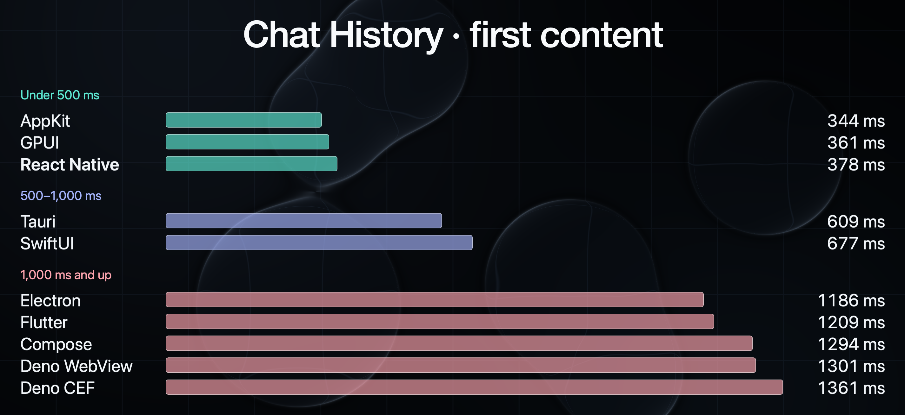
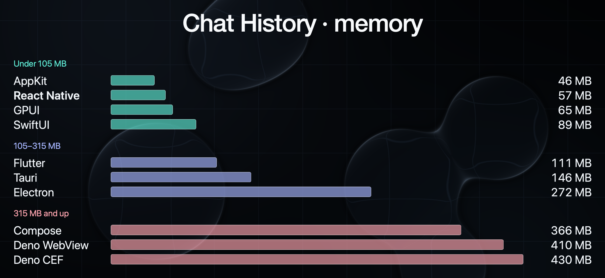
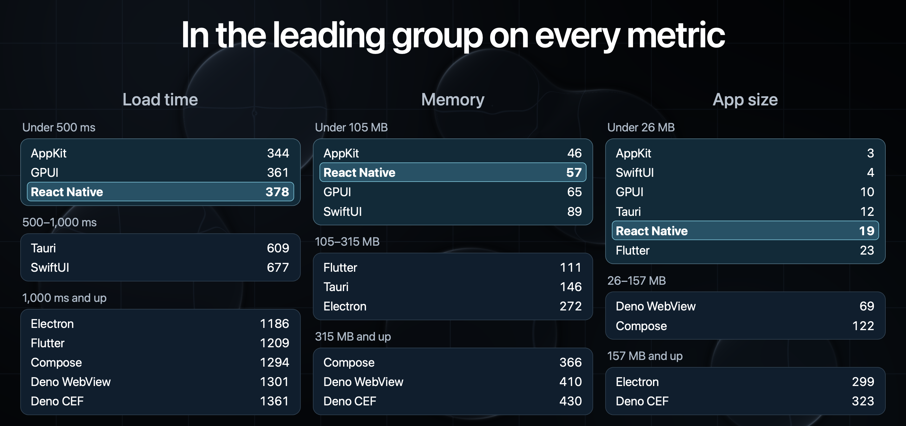
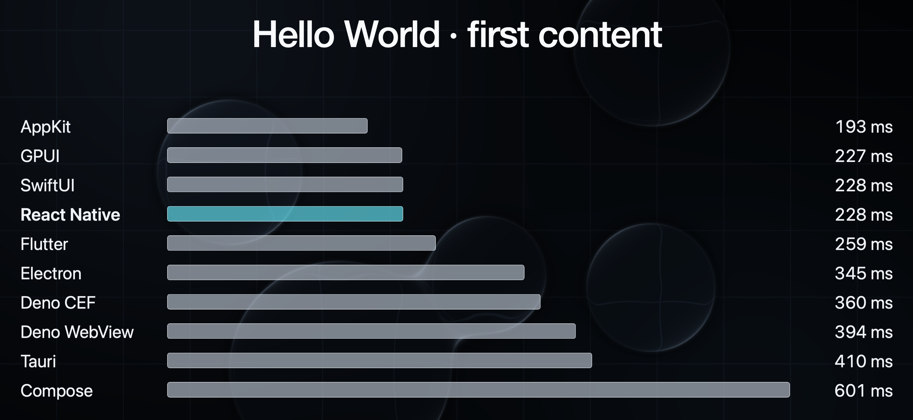
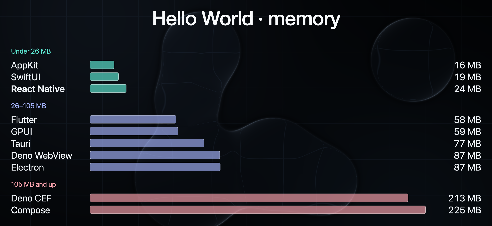

# Framework Benchmarks

Release-mode macOS apps in React Native, Electron, Tauri, Deno Desktop (WebView and CEF), Flutter, GPUI, Compose Multiplatform, SwiftUI, and AppKit. Two benchmarks, called suites here, separate framework overhead from product behavior:

- **Chat history:** ten apps browse pinned transcripts with Markdown and syntax highlighting.
- **Hello World:** ten apps display the same greeting, including both standalone React Native and the Legend Apps shell.

Each suite is a self-contained folder with its own apps, packages, and build/run/benchmark scripts, so a new benchmark (desktop or mobile) is one dispatcher entry plus one folder.

## Layout

```
ChatHistory/          apps/ (10) + packages/ + benchmark/ (harness, gitignored results/)
HelloWorld/           apps/ (10) + packages/ + benchmark/ (harness, gitignored results/)
shared/               capture helpers, video analysis, and the Gradle root both suites build through
benchmarks/           unified build/run/fixtures/download/release dispatcher, archived result sets
docs/                 long-form reports and methodology notes
assets/               app icon and the benchmark chart images below
.build/               built .app bundles, grammar packs, and toolchains (gitignored)
```

To add a suite: create `<Benchmark>/{apps,packages,benchmark}`, give `benchmark/` the same `build.ts` / `run.ts` / `benchmark.ts` entry points, and add the suite to `suiteDirectories` in `benchmarks/cli.ts`. Root `bun run benchmark:build` / `benchmark:run` then dispatch `--suite <name>` to it.

The [September 23–24 chat-history refresh](benchmarks/chat-refresh-2026-09-23/RESULTS.md) contains updated measurements and app sizes for all ten frameworks after rebuilding the current apps. All 100 scored videos and content checks passed. Hello World was not rerun; its table including Compose is in the [September 18 report](docs/COMPOSE_BENCHMARK_RESULTS.md#hello-world).

The earlier [September 17 results](benchmarks/final-2026-09-17/RESULTS.md), from before external grammar packs, contain separate tables for startup, memory, and built app size, including the latest [Flutter/GPUI rendering changes](ChatHistory/benchmark/FLUTTER_GPUI_OUTPUT_ALIGNMENT.md). All 19 bundles were rebuilt from clean committed source and validated against their recordings. Comparable features do not imply identical rendering engines or pixels; see the [fairness standard](ChatHistory/benchmark/FAIRNESS_STANDARD.md) and the report’s conditions and limitations. The earlier [September 16 results](benchmarks/final-2026-09-16/RESULTS.md) remain available for historical context.

The latest [built app sizes](benchmarks/BUILD_SIZES.md) come from a subsequent rebuild of all 19 apps with external grammar packs. They separate app, grammar-pack, and combined installed sizes; startup and memory were not rerun.

The illustrated [framework comparison report](docs/DESKTOP_FRAMEWORK_REPORT.md) combines the size tables, benchmark results, UI architectures, and framework tradeoffs with screenshots of all nine chat-history apps.

## Setup

Use a Mac with an active display. Install Bun and run `bun install` from this repository. Benchmarking requires Xcode command-line tools (for the measurement helpers), `ffmpeg`, and `ffprobe`. Grant Screen Recording permission to **Chat History Benchmark Capture** when requested; a first run may need to be restarted after granting access.

Building additionally requires the selected frameworks' toolchains: full Xcode and CocoaPods for React Native, Rust for Tauri/GPUI, Flutter for Flutter, and a Deno Desktop-capable toolchain for Deno. The scripts prefer repository-scoped tools in `.toolchains`, then `PATH`; they do not modify shell startup files. Dependencies may be downloaded during builds.

The chat-history React Native app and Hello World **Legend Shell** app come from the sibling `../legend-apps` checkout. Install that repository's dependencies too. Override its location with `LEGEND_APPS_REPO` or `--legend-apps-repo /absolute/path`; the unified builder uses that exact checkout, without switching to another worktree. Standalone Hello World React Native lives here and does not need the sibling.

## Build, then benchmark

```sh
bun install

# Preview all release builds, then confirm [y/N] before starting.
bun run benchmark:build

# Chat history only: select and pin local input files once.
bun run benchmark:fixtures

# Measure all existing builds; does not rebuild apps.
bun run benchmark:run
```

With no arguments, both commands select **all 20 apps across both workloads**, sequentially. Building replaces selected bundles under `.build/chat-history-benchmarks/` and `.build/hello-world-benchmarks/` and writes provenance manifests there. There is no implicit build during benchmarking. `bun run benchmark` is an alias for `benchmark:run`; unlike the old command, it no longer builds or selects only chat history.

The fixture selector uses your local Codex/Claude histories, choosing two large histories inactive for at least eight days. Paths and hashes stay in ignored `ChatHistory/benchmark/fixtures.local.json`. The runner verifies those files before measurement. Do not repin between comparative runs. Another person's corpus may produce different results. Hello World needs no history files; use `--suite hello-world` if you do not have a suitable corpus.

Keep the Mac **unlocked and otherwise idle** throughout measurement. The runner holds the display awake. Close other copies of these apps, particularly Deno apps using port 8000. The full default run can take over an hour, plus build time. Warmups exercise caches: these are fresh-process launches, not cold-machine or first-install measurements.

```sh
# Build and measure one technology in both workloads.
bun run benchmark:build --app gpui
bun run benchmark:run --app gpui

# Only the chat-history native apps.
bun run benchmark:build --suite chat-history --app appkit,swiftui
bun run benchmark:run --suite chat-history --app appkit,swiftui

# Short pipeline check, not publishable performance numbers.
bun run benchmark:run --suite hello-world --app electron --warmups 0 --iterations 1

# Inspect without starting work; explicitly bypass confirmation for automation.
bun run benchmark:build --dry-run
bun run benchmark:build --yes
bun run benchmark:run --dry-run
```

## Arguments and defaults

Both scripts accept `--name value` or `--name=value`. Unknown options and invalid values fail before execution. Use `--help` on either command.

| Argument | Commands | Default / behavior |
| --- | --- | --- |
| `--suite all\|chat-history\|hello-world` | Both | `all` |
| `--app all\|<comma-separated names>` | Both | `all`; names below |
| `--dry-run` | Both | Print selected apps, bundle directories, and underlying commands without executing |
| `--help` | Both | Show usage |
| `--yes` | Build | Skip confirmation; required without an interactive terminal |
| `--legend-apps-repo <path>` | Build | `LEGEND_APPS_REPO`, otherwise sibling `../legend-apps` |
| `--warmups <N>` | Run | `2` discarded rounds per app; minimum `0` |
| `--iterations <N>` | Run | `10` measured rounds per app; minimum `1` |
| `--settle-ms <N>` | Run | Hello World only: `5000` ms reference wait; minimum `1000`. With both suites, applies only to Hello World |

App names: `react-native`, `electron`, `tauri`, `deno-webview`, `deno-cef`, `flutter`, `gpui`, `compose`, `swiftui`, `appkit`. `deno` selects both backends. Selecting a technology without `--suite` selects its apps in both workloads. The chat-history Deno exporter always builds **both backends**, even when only one is requested; the preview shows this. Benchmarking still runs only the requested backend.

Suite-specific aliases are available: `benchmark:chat-history:build`, `benchmark:chat-history:run`, `benchmark:hello-world:build`, and `benchmark:hello-world:run`. Build aliases have the same confirmation. `benchmark:chat-history` and `benchmark:hello-world` are run-only aliases. Lower-level suite scripts are implementation/diagnostic entry points; use the commands above for normal builds and measurements.

Flutter release builds target ARM64 in both workloads, including the bundled engine and Dart code. These benchmark exports require Apple Silicon.

## External grammar assets

Chat-history grammars are installed in a shared folder beside the built apps. Builds and prebuilt downloads prepare the required packs automatically. Keep `.build/chat-history-benchmarks/grammar-packs/` alongside the apps when relocating them. The runner verifies pack hashes before measurement; loading and highlighting remain timed app work. New reports separate app size, grammar-pack size, and combined installed size. See [external grammar packs](ChatHistory/benchmark/EXTERNAL_GRAMMARS.md) for engine formats and release behavior. The September 17 figures predate this change.

## Results and recordings













### Latest chat-history numbers (September 23–24 refresh)

Medians over ten measured fresh-process launches per app; memory is settled physical footprint in MiB from separate unrecorded launches; sizes exclude external grammar packs. Full validation, spread, and conditions: [September 23–24 report](benchmarks/chat-refresh-2026-09-23/RESULTS.md).

| App | Window ms | First content ms | Jump ms | Switch ms | Initial MiB | App MiB | Grammar MiB |
| --- | ---: | ---: | ---: | ---: | ---: | ---: | ---: |
| AppKit | 244.1 | 344.3 | 82.6 | 96.7 | 43.6 | 3.2 | 1.3 |
| GPUI | 227.8 | 360.6 | 51.3 | 178.2 | 61.8 | 9.9 | 0.8 |
| React Native | 258.9 | 409.6 | 71.0 | 200.5 | 55.5 | 17.8 | 22.5 |
| Tauri | 275.6 | 609.0 | 73.6 | 227.2 | 139.7 | 11.5 | 0.1 |
| SwiftUI | 291.3 | 676.7 | 81.0 | 556.6 | 85.0 | 3.7 | 1.3 |
| Electron | 294.5 | 1185.8 | 70.6 | 604.1 | 259.0 | 285.6 | 0.1 |
| Flutter | 242.5 | 1209.0 | 80.2 | 753.2 | 105.4 | 21.5 | 0.6 |
| Compose | 626.6 | 1294.0 | 85.0 | 378.8 | 348.6 | 116.5 | 3.4 |
| Deno WebView | 259.6 | 1301.2 | 75.2 | 660.1 | 390.8 | 65.8 | 0.1 |
| Deno CEF | 327.2 | 1360.7 | 71.1 | 687.3 | 410.3 | 307.8 | 0.1 |

### Hello World reference (September 17–18 builds)

Hello World was not rerun in the September 23–24 refresh. This is the reference table including Compose from the [September 18 report](docs/COMPOSE_BENCHMARK_RESULTS.md#hello-world); Legend Shell is excluded as a duplicate RN host and Hello World has no grammar pack.

| App | Window ms | First content ms | Memory MiB | App MiB |
| --- | ---: | ---: | ---: | ---: |
| AppKit | 193.4 | 193.4 | 15.5 | 0.1 |
| GPUI | 210.7 | 226.5 | 56.3 | 5.3 |
| SwiftUI | 210.9 | 227.5 | 18.3 | 0.1 |
| React Native | 210.9 | 227.6 | 23.3 | 7.2 |
| Flutter | 234.4 | 259.2 | 55.0 | 17.0 |
| Electron | 277.6 | 344.5 | 83.4 | 285.1 |
| Deno CEF | 359.3 | 360.0 | 203.6 | 307.0 |
| Deno WebView | 360.9 | 394.1 | 83.0 | 65.0 |
| Tauri | 377.5 | 409.8 | 73.0 | 10.3 |
| Compose | 593.8 | 600.5 | 214.6 | 113.3 |

Older synchronized full-suite tables live in [September 17 results](benchmarks/final-2026-09-17/RESULTS.md) and [September 16 results](benchmarks/final-2026-09-16/RESULTS.md); per-app installed sizes with grammar packs are in [built app sizes](benchmarks/BUILD_SIZES.md).

[Latest RN measurements and full chat-history reference table](docs/REACT_NATIVE_BENCHMARK_RESULTS.md) include the September 19 ten-run baseline/update comparison. Other framework rows retain their earlier measurements.

The runner checks that all selected bundles and provenance records exist before starting either workload. It validates chat rendering-policy provenance; each suite performs its additional fixture/content checks. It stops on failure, preserving completed observations. Fix the cause and rerun; it does not automatically resume or rebuild. Source edits do not update existing bundles—rebuild changed apps explicitly.

Defaults are two discarded warmup rounds and ten measured rounds with rotating app order. Visible timings come from recordings, with a separate unrecorded launch for settled physical memory. Reports also include logical `.app` bundle size (not compressed download size). Native capture/measurement helpers may be compiled during a run; application bundles are not rebuilt.

Each workload produces its own JSON and Markdown results table:

- Chat history: `ChatHistory/benchmark/results/<timestamp>.json`, `.md`, observation journal, and `<timestamp>-videos/`.
- Hello World: `HelloWorld/benchmark/results/<timestamp>/results.json`, `results.md`, observation journal, videos, and `videos.html`.

Keep the full result directories to review recordings later. These generated artifacts are gitignored. App-reported stages are diagnostics; use the video-derived columns for comparisons. See the [chat-history methodology](ChatHistory/benchmark/README.md) and [Hello World methodology](HelloWorld/benchmark/README.md) for detection, sampling, retries, and limitations. The unified runner does not automate the additional idle-CPU, thermal, bundle-hash, and visual-review audit used for the September 17 report (which does not include fresh per-app idle CPU measurements); review machine conditions and evidence before publishing results.

An optional paired report can be generated from two completed runs:

```sh
bun run benchmark:compare \
  --product ChatHistory/benchmark/results/<timestamp>.json \
  --hello-world HelloWorld/benchmark/results/<timestamp>/results.json \
  --output comparison.md
```

## Prebuilt releases

The release tooling packages all 20 apps and lets benchmark users download either the complete set or selected apps. A release must be published before downloads can work; setting up these scripts does not itself create one.

Install the GitHub CLI (`gh`), authenticate with `gh auth login`, and have Python 3 available alongside the measurement prerequisites above. You do **not** need Flutter, Rust, Deno, CocoaPods, or the sibling repository to benchmark downloaded apps. Xcode command-line tools are still required for measurement helpers. Download into a clean checkout of this repository at the release's tag; the downloader checks the exact source commit.

```sh
# From a checkout at the published release tag:
bun install
bun run benchmark:download --repo OWNER/REPO
bun run benchmark:fixtures  # Once, only when measuring chat history
bun run benchmark:run

# Pin a release and download only a subset.
bun run benchmark:download --repo OWNER/REPO --release bench-v1 --suite hello-world --app gpui
bun run benchmark:run --suite hello-world --app gpui
```

`--repo` defaults to `BENCHMARK_RELEASE_REPO`, then this checkout's GitHub `origin`. The release defaults to `latest`; it is resolved once, and the exact tag, manifest checksum, archive checksums, and bundle hashes are retained in the build manifests and benchmark JSON. `--suite` and `--app` have the same defaults and names as the builder. Chat-history Deno downloads include both backends because they share a build provenance record.

The downloader verifies GitHub's SHA-256 asset digests, manifest checksums, extracted file contents/permissions/symlinks, and code signatures. It stages all selected apps before replacing local bundles, and attempts rollback on installation errors. It preserves unselected apps. The benchmark runner rejects comparisons mixing local and release builds, different releases, or modified release bundles; download a matched set or rebuild all selected apps. The harness must remain clean at the release commit. Do not download or rebuild apps while a benchmark is running.

Each release currently targets one CPU architecture and conservatively requires the packaging Mac's macOS version or newer. This is a declared support floor, not a measurement of the oldest OS every framework could support. Current exports use ad-hoc signatures; these scripts verify code integrity but do not sign with a distribution identity or notarize apps. Gatekeeper approval and capture permission may still be needed on a new machine. No script disables Gatekeeper or removes quarantine.

### Publish a release

This is an explicit local publishing workflow, suitable for the configured Mac with all framework toolchains. It does not introduce a CI runner dependency. Commit the intended changes in **both** repositories and install their locked dependencies before building. All selected build records must be from those clean commits and include the build-time toolchain metadata. Existing dirty or stale builds are rejected rather than relabeled.

```sh
# On the release build Mac, from clean source checkouts:
bun run benchmark:build
bun run benchmark:release:package --tag bench-v1

# Push this exact comparison source commit/tag to the destination repository.
git tag bench-v1
git push origin HEAD
git push origin bench-v1

# Use the output directory printed by the packager (arm64 shown here).
bun run benchmark:release:publish \
  --repo OWNER/REPO \
  --directory .build/releases/bench-v1-macos-arm64
```

Packaging never builds or publishes. It requires all 20 apps and writes one `.tar.gz` per app, `benchmark-release.json`, and `SHA256SUMS`. Archives preserve executables and framework symlinks and exclude filesystem owner names and extended attributes. The manifest includes both source commits, per-app build-time tool versions, packaging-host tool versions, rendering policy, architecture, and signing limitations. Personal histories, local fixture manifests, videos, credentials, and source checkout paths are not added as release assets. Matching harness source is available through the release tag.

Publishing verifies the package checksums and requires the existing remote tag to point to the packaged comparison commit. It creates a draft, uploads the entire set, then publishes it as latest. Use `--draft` to leave the completed release unpublished for review. Existing releases are never overwritten. If uploading fails, the incomplete draft remains unpublished; inspect and remove that draft before retrying the command. Ensure the pinned `legend-apps` commit is also retained in its source repository.

| Command | Additional arguments |
| --- | --- |
| `benchmark:download` | `--repo OWNER/REPO`, `--release latest\|TAG`, `--suite`, `--app` |
| `benchmark:release:package` | Required `--tag TAG`; optional `--output NEW_DIRECTORY`, `--legend-apps-repo PATH` |
| `benchmark:release:publish` | Required `--directory PACKAGE_DIRECTORY`; optional `--repo OWNER/REPO`, `--draft` |

Every command supports `--help`. Package output defaults to `.build/releases/<tag>-macos-<arch>` and must not already exist. Custom output directories must be gitignored or outside the source checkout so packaging does not dirty the release source. Release names use letters, digits, dots, underscores, or hyphens. For normal user runs, downloading all individual archives with one command provides the complete set without maintaining a second, duplicate all-app archive.

Enable [GitHub release immutability](https://docs.github.com/en/code-security/how-tos/secure-your-supply-chain/establish-provenance-and-integrity/prevent-release-changes) in the destination repository before publishing. This prevents later replacement of published assets and tags. The tools verify digests even without that setting, but do not enable it automatically. Before advertising a release, validate launch behavior on a second Mac and run the default benchmark suite; publishing itself does not perform performance or visual validation.

Release regression checks: `bun test benchmarks/releases/releases.test.ts` and `python3 benchmarks/releases/archive_test.py`.

## Develop an app

`bun run chat-history:<framework>` starts the selected product (`deno:webview` or `deno:cef` for Deno). `bun run hello-world:<framework>` builds and opens one baseline directly; these are developer shortcuts, not the confirmed batch builder. See the workload READMEs for individual commands and architecture.

CLI checks: `bun test benchmarks/cli.test.ts`; TypeScript validation: `bun run typecheck`.

## Compose Multiplatform

Both workloads are available as `--app compose`:

```sh
bun run benchmark:build --app compose
bun run benchmark:run --app compose
```

The builder installs a checksum-pinned ARM64 JDK and Gradle under `.toolchains/compose`, runs Compose's ProGuard release build, and packages a trimmed JVM. No system Java installation is needed to run the exported apps. First build downloads approximately a gigabyte of toolchains and dependencies; allow several gigabytes for caches and build outputs. The build monitors the machine's 50 GB disk reserve.

Chat History uses Kotlin/JVM file discovery and lazy UTF-8 transcript parsing, CommonMark, native Compose text, a lazy list, and an external JVM syntax pack. It shares benchmark fixtures, normalization semantics, and highlighting policy with the other apps. No Rust parser or WebView is embedded. See [implementation and fairness notes](docs/COMPOSE_MULTIPLATFORM.md).

[Compose measurements and updated reference tables](docs/COMPOSE_BENCHMARK_RESULTS.md) now include ten-run results for both workloads. Other framework rows retain their earlier measurements; this is not a synchronized full-suite rerun.
